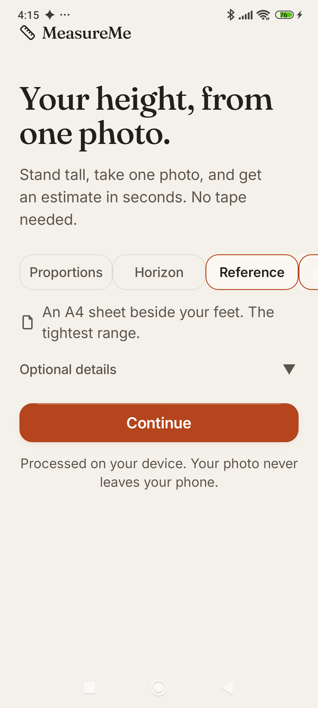
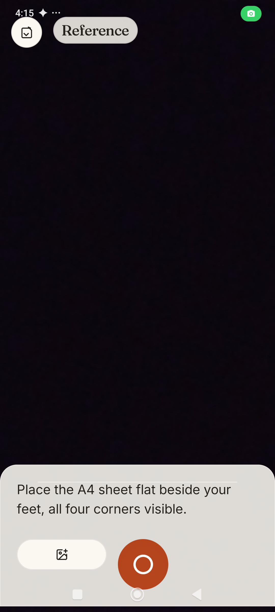
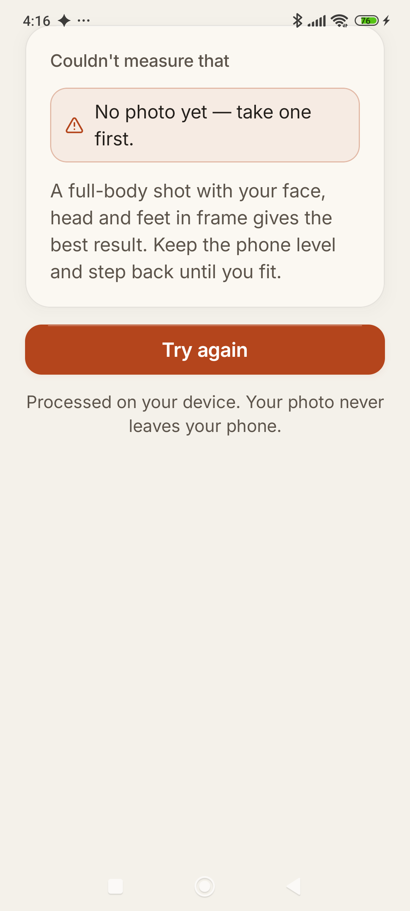

# MeasureMe

Estimate a person's height from **one full-body photo** — entirely on-device.
No account, no upload, no server. The photo never leaves the device.

This repository holds the Android app (`android/`), the web prototype (the
original browser MVP — root `index.html`, `css/`, `js/`, plus the `web/`
build of the reference design), the design reference (`design/`), and the
product documents (`docs/`).

> **It's an estimate, not a measurement.** The model assumes average body
> proportions, so expect an error of a few centimetres (the app shows a
> per-photo error bar of roughly ±3.5–15%). It is not suitable anywhere an
> exact height is required.

---

## Documentation

- [Product Requirements (PRD)](docs/01_MeasureMe_PRD.pdf)
- [Tech Stack](docs/02_MeasureMe_Tech_Stack.pdf)
- [Technical Design](docs/03_MeasureMe_Technical_Design.pdf)
- [UI Design Spec](docs/04_MeasureMe_UI_Design_Spec.pdf)

---

## App Screenshots

### App Preview

| Home | Camera | Result |
| :---: | :---: | :---: |
|  |  |  |

The premium UI overhaul: a full-bleed camera preview with zero drawn overlays, a floating glass bottom sheet with exact spec §7 copy, a contextual segmented control replacing the mode cards, and a floating result card with a spring count-up and explicit error range.

---

## 1 · Quick start

Any static server works:

```bash
cd MeasureMe
python -m http.server 8000
# → http://localhost:8000
```

You can also just double-click `index.html` (the app uses classic scripts, not
ES modules, so `file://` works). One caveat: the **automatic** detector
downloads the pose model (~9 MB) from a CDN on first use, so it needs internet
the first time. **Manual mode works completely offline.**

Flow: **Add a photo → Estimate height → read cm / ft-in + confidence + the
exact formula** (open *"How this was calculated"*). If detection fails, the app
offers **"Set points manually"**.

---

## 2 · How it works (architecture)

Four layers, each replaceable on its own:

```
 photo ──► detector.js ──► geometry.js ──► anthropometry.js ──► ui.js / overlay.js
          MediaPipe        pixels            centimetres          DOM + canvas
          Pose             + quality         + confidence
```

### Layer 1 — Detection (`js/detector.js`)

- [MediaPipe Tasks Vision](https://ai.google.dev/edge/mediapipe/solutions/vision/pose_landmarker)
  `PoseLandmarker` (pinned `@mediapipe/tasks-vision@0.10.35`, model
  `pose_landmarker_full`) — 33 body landmarks, running on-device (WebAssembly /
  WebGL).
- Lazy-loaded with a dynamic `import()` only when a photo is submitted; GPU
  delegate first, automatic CPU fallback; 30 s timeout.
- The photo is downscaled to ≤1440 px on the long edge before detection (speed,
  and it keeps the pixel thresholds meaningful).
- Up to 2 people are detected so the UI can warn about bystanders; the largest
  pose is measured.

### Layer 2 — Geometry (`js/geometry.js`) — landmarks → pixels

- Landmarks are converted to **analysis-canvas pixels** with a visibility gate.
- **Head height in pixels** comes from a **least-squares fit** of the facial
  landmarks, not from one point: eyes, nose and mouth sit at known fractions of
  head height (0.47 / 0.72 / 0.84 × crown→chin), so fitting
  `y = crownY + headPx · depth` through them uses all of them at once and is
  robust to a single noisy point. Fallback ladders: eye-spacing span (`/0.33`),
  then ear-to-ear width (`/0.64`). A fit error (RMS px) is reported for the
  confidence model.
- **Feet**: the lowest visible point of both feet (ankle/heel/toe landmarks),
  which are *contact points*; the toe-tip landmark floats ~0.7 cm above the
  floor, which the model corrects later.
- **Posture guards**: camera roll is deskewed from the foot contact line (only
  if ≤10°, otherwise flagged and not corrected); body lean is measured and
  cos-corrected up to 10°; knee straightness is measured.
- Everything lands in a `measurements` object with a **quality bag**
  (visibility, head-fit RMS, size/span/margins factors, roll/lean factors…)
  that the confidence model consumes.

### Layer 3 — Anthropometry (`js/anthropometry.js`) — pixels → cm + confidence

The visible, tunable core (exactly what the app prints):

```
height_cm = (person_pixel_height / anchor_pixel_length) × anchor_cm   + 0.7
```

Three **anchors** (body parts with a known average length) each produce their
own estimate; the result is a weighted mean:

| Anchor | Average | Anchor weight | When it lands |
|---|---|---|---|
| Head height (crown→chin) | 23 cm (slider 21–25) | 1.0 | primary model |
| Head width (ear→ear) | 14.9 cm | 0.45 | when head height is unreliable |
| Shoulder joints (biacromial, landmark 11–12) | 34 cm | 0.22 | last resort |

- An anchor's **weight** is scaled by its quality (visibility × facial-fit
  agreement × head size in frame). Head anchors are sanity-checked against
  human proportions: an anchor implying an absurd **heads-tall ratio** (outside
  6.4–8.3) is *excluded* and reported as such in the trace — a bad facial fit
  can't poison the blend.
- The **+0.7 cm** covers the gap between the big-toe landmark and the floor.
- The **head-size slider** retunes `headCm`; head width scales with it too
  (same head), so the slider moves every head-based result.
- Estimates outside 120–235 cm are **rejected** rather than shown.

**Confidence** (`0–100`):

```
conf = 0.92 × coverage × agreement^0.35 × poseQ × frameQ × plausQ
```

- `coverage` — how much anchor weight landed; `agreement` — how close the
  anchors are to each other; `poseQ` — roll/lean/knees; `frameQ` — subject
  size/span/margins; `plausQ` — heads-tall plausibility. Manual mode is capped
  at **0.65** — taps can never beat detection.
- Full formula with the actual numbers is printed in *"How this was
  calculated"*, factor by factor.
- **Error bar**: `3.2% + (1 − conf/0.92) × 11%`, clamped to 3.5–15% of height.
  3.2% ≈ "several cm" on an adult — deliberately honest; the app never claims
  98–100% accuracy.

### Layer 4 — UI (`js/ui.js`, `js/overlay.js`, `js/manual.js`, `js/app.js`)

- Six designed phases: `empty · ready · analyzing · error · manual · result`.
  `ui.js` is the only module that writes to the DOM.
- `overlay.js` draws the result on a canvas over the photo: crown/feet markers,
  a ruler-ticked **dimension line** with the cm label, head bracket and the
  head-pixel chip — all drawn with a white outline pass so they stay readable
  on any photo.
- `manual.js` implements the 3-tap fallback with draggable pins and a
  magnifier loupe (positioned opposite the finger).
- `app.js` orchestrates: file loading, settings (head-size slider, debug
  toggle — persisted in `localStorage`), error → recovery tips, and a small
  `MM.app.testing` hook used by the automated tests (see §6).

### Why 3 taps, not 2? (manual mode design note)

A two-point span (top of head → feet) contains **no scale**: without a
reference object, every pixel ratio is dimensionless — there is nothing to
convert pixels to centimetres with. The **chin tap supplies the anchor**: it
makes the head measurable in pixels, and the head is the "ruler". Hence manual
mode asks for **crown → chin → heels** (3 taps). Taps can be dragged and
fine-tuned; an implausible trio produces an inline, actionable warning
("About 9.5 heads tall — point 2 is probably too high…") instead of a dead end.

---

## 3 · Constants (`js/constants.js`)

Every tunable, why it exists:

| Constant | Value | Why |
|---|---|---|
| `DEFAULT_HEAD_CM` | 23.0 | Adult crown→chin average (m ≈ 23.3, f ≈ 22.2 cm). Biggest population variable → exposed as a 21–25 cm slider. |
| `HEAD_WIDTH_CM` | 14.9 | Ear-to-ear (bitragion) average; the fallback anchor when head height is unreliable. More variable between people → weight 0.45. |
| `SHOULDER_JOINT_CM` | 34.0 | Distance between shoulder *joint centres* (landmark 11–12 sit inside the acromion). ±13% population spread → last-resort weight 0.22. |
| `SOLE_TO_TOE_TIP_CM` | 0.7 | The toe landmark floats above the floor; added back to every estimate. |
| `FACE_DEPTH_EYES/NOSE/MOUTH` | 0.47 / 0.72 / 0.84 | Where eyes/nose/mouth sit along crown→chin in a frontal face. These are the least-squares "rulers" for the head fit. |
| `EAR_WIDTH_TO_HEAD_HEIGHT` | 0.64 | Converts ear-to-ear width into an independent head-height estimate. |
| `HEADS_TALL_MIN/MAX` | 6.4 / 8.3 | Plausible adult photo ratios; anchors outside are excluded, results outside get a warning + plausibility penalty. |
| `HEIGHT_MIN/MAX_CM` | 130 / 225 | Soft plausibility window (confidence penalty outside). |
| `HEIGHT_HARD_MIN/MAX_CM` | 120 / 235 | Hard rejection bounds — no result is shown outside these. |
| `MAX_CONFIDENCE` | 0.92 | The method can never claim 98–100%. |
| `MANUAL_MAX_CONFIDENCE` | 0.65 | Manual taps are capped below any decent detection. |
| `MIN_HEAD_PX` / `GOOD_HEAD_PX` | 24 / 56 | Below 24 px of head height, facial landmarks are guesswork; 56 px is "solid". Feeds the size factor. |
| `MAX_ROLL_DEG` / `MAX_LEAN_CORRECTION_DEG` | 10 / 10 | Only correct poses we can trust; beyond → flag instead of "fixing". |
| `KNEE_STRAIGHT_DEG` / `KNEE_SUSPECT_DEG` | 168 / 130 | Standing straight vs. clearly crouching. |
| `LEAN_GOOD_DEG` / `LEAN_BAD_DEG` | 2 / 15 | Straightness factor ramp for near-vertical vs. obviously leaning. |
| `ANCHOR_WEIGHT` | 1.0 / 0.45 / 0.22 | Relative trust: head height ≫ head width ≫ shoulders. |
| `ERROR_PCT_AT_MAX` / `ERROR_PCT_RANGE` | 3.2 / 11.0 | Error-bar interpolation: the honest "several cm" floor and how fast it grows as confidence drops. |
| `MODEL_CDN` / `POSE_MODEL_URL` | MediaPipe (pinned) | Version-pinned so the model can't shift under the app. |
| `MAX_ANALYSIS_DIM` | 1440 | Downscale long edge before detection: speed + stable px thresholds. |
| `NUM_POSES` | 2 | Detect a bystander to warn about it; largest pose is measured. |
| `LM` | indices | The BlazePose landmarks used (nose, eyes, ears, mouth, shoulders, hips, knees, ankles, heels, toes). |
| `VIS_MIN` / `VIS_LOW` | 0.35 / 0.25 | Visibility gates; feet get a looser bar because shoes/occlusion. |

---

## 4 · Known limitations

- **No perspective correction.** A level, mid-body camera is assumed; a
  low/high camera angle stretches proportions. Only roll (≤10°) and modest lean
  (≤10°) are corrected.
- **The head is the ruler.** Hair volume, hats, headbands change apparent head
  size; a tilted/down-pitched head fools the facial fit (the app detects this,
  excludes the bad anchor and lowers confidence — but can't recover the truth).
- **Children.** The model is adult-proportioned (≈7.5 heads); kids have
  relatively larger heads → the plausibility window flags it and results are
  unreliable.
- **Non-standing poses.** Sitting, crouching, walking blur, or cross-legged
  (the bundled yoga-pose test photo lands at "rough" confidence, correctly).
- **Group photos.** The largest person is measured; others trigger a note.
- **Old/vintage photos** (the test set includes one) have lens and print
  distortion; expect the "unusually high heads-tall" warning to fire.
- **Clothing and footwear**: bulky shoes add a cm or two below the heel point;
  barefoot is best.
- **Absolute accuracy is unknowable from one uncalibrated photo.** The error
  bar is the honest statement; a reference object or a second view would be
  required for real accuracy.
- **Manual mode depends on tap precision** (± a few px per tap ≈ ±1–2 cm per
  1% head error) — the loupe helps, and confidence is capped at 65.

**Privacy:** detection and math run on-device. The only network request is the
one-time pose-model download from the CDN.

---

## 5 · Project structure

```
index.html            single page, all six states in markup
css/styles.css        mobile-first design system (light + dark)
js/constants.js       every tunable number, with reasons (§3)
js/detector.js        MediaPipe wrapper: lazy load, GPU→CPU, downscale
js/geometry.js        landmarks → pixels + quality bag + posture guards
js/anthropometry.js   pixels → cm + confidence + trace (pure math)
js/overlay.js         canvas drawing: markers, dimension line, pins, loupe
js/manual.js          3-tap manual mode: pointer input, drag, loupe
js/ui.js              the only DOM writer; phase matrix, result/error cards
js/app.js             orchestration, settings, testing hook
docs/shots/           screenshots of every state (01–09)
.test/                agent-browser batch scripts + test photos (dev only)
android/              separate native Kotlin/Compose implementation of the
                      same pipeline — not covered by this README
```

## 6 · For students & testers

- Read the layers in order: `constants → geometry → anthropometry`. The
  anthropometry module is pure functions — easy to run in isolation in any JS
  console: `MM.anthropometry.estimate(meas, { headCm: 23 })`.
- A console hook exists for testing/teaching:
  `MM.app.testing.state()`, `.dump()`, `.loadFromUrl(url)`, `.runAuto()`,
  `.enterManual()`, `.setManualPoints([[x,y]…])` (normalized 0–1),
  `.manualCalc()`, `.setHeadCm(cm)`.
- `.test/` contains the [agent-browser](https://www.npmjs.com/package/agent-browser)
  batch files used to verify every state end-to-end (uploads, taps, drags,
  sliders, failures) plus test photos from Wikimedia Commons and the
  MediaPipe demo assets — **dev-only, not shipped assets**; check each
  license before reusing.
- `docs/shots/` — one screenshot per state:
  `01-empty · 02-result · 03-manual-warning · 04-manual-pins ·
  05-manual-result · 06-calculation-expanded · 07-error ·
  08-light-result · 09-result-overlay`.
